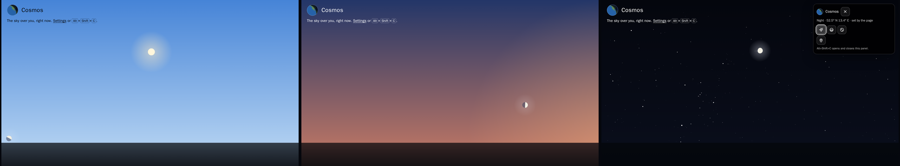

# Cosmos

The live sky over your visitors as a calm page background: sun, moon, stars and twilight at their place and time, in one dependency-free ES module.



## Features

- **Live sky**: the sun, the moon with its phase, about 900 bright stars and every twilight stage, computed in the browser for the current minute.
- **Place without asking**: the browser's time zone places the sky; once the visitor allows it, the browser position refines it, rounded to about 1 km and kept on the device.
- **Phones**: the sky turns with the device once motion sensors are allowed.
- **Design hooks**: `--cosmos-*` custom properties and `data-cosmos-*` marks on `<html>`, including a text color that keeps 4.5:1 against the sky.
- **Menus**: the `<cosmos-globe>` icon, the `Alt+Shift+C` hotkey, `window.cosmos` and `cosmos:*` events open the settings from any menu.
- **Polite**: a page with its own background keeps it, frames get colors only, and the visitor's choice of `full`, `colors` or `off` is remembered.
- **Small and private**: one module, no dependencies, no network requests, fit for a strict Content Security Policy.

## Quick start

```html
<script type="module" src="https://cosmos.example.org/js/cosmos.js"></script>
<cosmos-sky></cosmos-sky>
```

`Alt+Shift+C` opens the settings. Attributes, properties and menu hooks: [Embedding.md](./Embedding.md).

## Infinito.Nexus

[ansible/roles/web-app-cst-cosmos/](./ansible/roles/web-app-cst-cosmos/) is a custom role: it serves the standalone cosmos page and publishes the library on the CDN for every designed app. Put the host into the group `web-app-cst-cosmos`, declare the source in the inventory and place the role with `make roles-pull inventory=<inventory>`:

```yaml
applications:
  web-app-cst-cosmos:
    custom: true
    source:
      url: https://github.com/kevinveenbirkenbach/cosmos.git
      version: v0.1.0
      path: ansible/roles/web-app-cst-cosmos
```

## Development

- [cosmos.js](./ansible/roles/web-app-cst-cosmos/files/javascript/cosmos.js) is the library; `node --test tests/` runs its [unit tests](./tests/).
- `python3 -I tools/data.py` rebuilds the embedded stars, land mask and time zones from the pinned sources in [NOTICE.md](./NOTICE.md).
- [docs/requirements/](./docs/requirements/) holds the requirements.

## License

[MIT](./LICENSE); third-party data: [NOTICE.md](./NOTICE.md).
