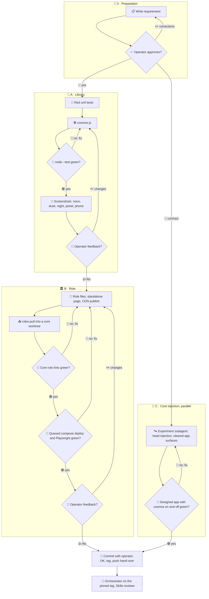

# 001 - Cosmos

## User Story

As the operator and designer of Infinito.Nexus, I want one live cosmos, the
real sky over the viewer at the current time, delivered as a
standalone-deployable role and as one embeddable library, so that every app,
the orchestrator and any other page show the same calm corporate background
without carrying its code twice.

## Decisions (operator-confirmed 2026-11-11; do not re-litigate)

Carried over from skills requirement 002 (operator-confirmed 2026-11-06):

1. **Scope**: only the cosmos itself moves here: sun, moon, stars, twilight
   stages and the day and night palettes with their contrast check. The
   generated music, the radio streams and the 3D agent graph stay in the
   orchestrator (operator 2026-11-11). Rejected: music and the 3D scene in
   cosmos (002 decision 1).
2. **Repository**: `github.com/kevinveenbirkenbach/cosmos`, not managed by
   pkgmgr, holding the Infinito.Nexus custom role at
   `ansible/roles/web-app-cst-cosmos/`, which core pulls from its
   inventory-declared source (core requirement 046), like the store and
   security roles. Rejected: the infinito-nexus organisation, a
   pkgmgr-managed release, and the repository root as the role, because core's
   pull requires `source.path` to end in a directory named after the group.
3. **Form**: Web Components that set `--cosmos-*` CSS custom properties every
   design can follow; a `colors` mode draws nothing. Rejected: a plain ES
   module API without elements.
4. **Licence**: MIT. Rejected: the Infinito.Nexus Community License, which is
   non-commercial and limits reuse.
5. **Icons**: seven self-designed stroke icons, inlined as SVG paths (design
   round, operator-approved 2026-11-11 ~23:55: no Bootstrap Icons in sites).
   Rejected: Bootstrap Icons, the first pick of this decision; the shared
   brand sprite, because cosmos must also run on pages without the brand
   role.

Decided 2026-11-11:

6. **Ownership**: the holder of the claim `work/cosmos` owns the cosmos and
   the unified background of every app. Skills hands requirement 002 over;
   the same holder switches the orchestrator to a pinned cosmos tag in a
   skills worktree under Skills' review (Skills, 2026-11-11 22:03). Experiment
   builds the core injection in a separate, iterating subagent. Rejected:
   Skills extracting and IAM integrating (002 decision 6).
7. **Timing**: now. Rejected: waiting for skills requirement 001 (002
   decision 7).
8. **One source, two deliverables**: the role deploys standalone and serves a
   full-screen cosmos page on its own domain; the same files are the
   embeddable library. Rejected: a role without its own page, a library in a
   second repository.
9. **Delivery into apps**: the role publishes the library into the shared CDN
   tree of `web-svc-cdn`; every designed app loads it same-origin from
   `/_infinito/cdn/roles/web-app-cst-cosmos/latest/js/cosmos.js` through the
   head injection, so no app CSP changes and onion vhosts work unchanged.
   Rejected: loading from the cosmos domain (CSP, CORS, onion sibling, and the
   cross-origin traps of textures and icon sprites), a bridge iframe that
   shares GPS across apps (`frame-src` in every app), colors only in apps.
10. **One file**: the library is one native ES module without imports and
    without build step; core busts caches with a `?v=` on the entry URL, which
    the module hands on to every asset it loads. Rejected: several modules, whose relative imports go stale under the
    pinned `latest` CDN path; a TypeScript or npm build.
11. **Controls**: no floating element in apps. `Alt+Shift+C` opens and closes
    the settings panel, is ignored inside text fields and is overridable per
    deployment. Apps hook the panel into their own menus through the
    `<cosmos-globe>` menu icon, a `data-cosmos-open` attribute, a
    `window.cosmos` API with events, and the `#cosmos` URL hash. The live globe
    (real Earth rotation, day and night line) shows on the standalone page and
    wherever an app places `<cosmos-globe>`. Rejected: a 48 px globe floating
    in every app (002 decision 4), double-Shift.
12. **Location and time**: the device clock gives the time. The location comes
    without any prompt on load from the timezone (tzdata coordinates); precise
    GPS is used silently when the browser already grants it, else only after a
    click in the panel. Coordinates stay in the browser's per-origin storage
    and never reach a cookie or a server. When the timezone hides the place
    (`UTC`, `Etc/*`, as Tor Browser reports), the deployment default applies:
    the place of the host's timezone, which core passes as `zone` from
    `HOST_TIMEZONE`, unless the page passes coordinates. Rejected: a GPS prompt
    on the first visit of every app, one fixed company location for everybody,
    role variables for coordinates that `HOST_TIMEZONE` already implies.
13. **Shared preferences**: the non-personal settings (on or off, mode,
    orientation) live in one cookie on the deployment's parent domain, so switching cosmos off once switches it off in every app.
    Rejected: per-app settings only, because an accessibility off-switch must
    hold everywhere; sharing through an iframe.
14. **Phone orientation**: on a phone the sky shows the direction the phone
    points at (compass heading and tilt from DeviceOrientation). It follows
    by default where no prompt stands in the way: browsers without
    `DeviceOrientationEvent.requestPermission`, and browsers with it whose
    Permissions API already reports the motion sensors granted (Chrome on
    Android since it added `requestPermission`). Elsewhere, as on iOS, it
    asks for the motion permission only on a tap in the panel;
    `prefers-reduced-motion` keeps the sky still. Rejected: parallax only,
    camera AR; treating every `requestPermission` browser as iOS (Chrome
    158 on Android then never followed, deploy 2026-11-12).
15. **Real sky**: stars come from a bright-star catalogue whose licence passes
    `kvb-check-legal`, placed for the viewer's place and time like sun and
    moon; the Earth of the globe comes from public-domain Natural Earth land
    data. Rejected: the orchestrator's seeded random stars, which a phone held
    against the real sky exposes.
16. **Rendering**: Canvas2D at device-pixel ratio 1, repainted once a minute
    and continuously only while the phone moves or the panel is open, paused
    while the document is hidden; inside a frame, such as an app opened in the
    dashboard, only the `colors` mode runs. Rejected: WebGL2 or WebGPU
    (context caps, context loss and GPU memory per tab for a picture that
    changes once a minute).
17. **Theme ownership**: cosmos writes only `--cosmos-*` properties, through
    an adopted `:root` stylesheet, and `data-cosmos-*` attributes; it never
    touches `--design-*`, `color-scheme`, `data-design-theme` or the `style`
    attribute of `<html>`, so the core palette keeps its contrast guarantee.
    Rejected: the orchestrator's un-namespaced `--bg` and `--text` writes;
    inline properties on `<html>` (Experiment, 2026-11-11 23:45).
18. **Strict CSP**: the module needs no inline script or style; it styles
    through constructable stylesheets and the CSSOM, and loads every asset
    from its own origin. Rejected: inline `<style>` elements and style
    attributes.
19. **Covered pages**: CSS paints the `html` background, and the `body`
    background when `html` has none, on the canvas beneath the fixed sky
    layer, so neither hides the stars of a page that never opted in.
    The library draws stars only while `html` and `body` both compute a
    transparent background color and no background image; else it stays in
    the colors, marks itself `data-covered` and says so in its panel. Apps
    opt in by clearing both under `html[data-cosmos-mode="full"]`. Rejected:
    a per-app list in the library; trusting every app to clear `html`
    (Experiment, 2026-11-12 08:38).

## Approach

## Acceptance Criteria

### Repository

- [ ] `LICENSE` holds the MIT licence, and `NOTICE.md` names the licence of
      every vendored or data file.
- [ ] `pkgmgr list` does not list cosmos.
- [ ] `ansible/roles/web-app-cst-cosmos/` is the role: `README.md`,
      `meta/main.yml`, `meta/info.yml`, `meta/services.yml`,
      `meta/domains.yml`, `meta/license.yml`, `vars/main.yml` with
      `application_id: web-app-cst-cosmos`, `tasks/main.yml`, `templates/` and
      `files/`.
- [ ] `docs/requirements/001-cosmos.md` is this file.

### Library

- [ ] `ansible/roles/web-app-cst-cosmos/files/javascript/cosmos.mjs` is one ES
      module with no `import`; a page that loads it through
      `<script type="module">` has `<cosmos-sky>` and `<cosmos-globe>`
      defined.
- [ ] A script tag that carries `data-cosmos` (JSON config) mounts exactly one
      `<cosmos-sky>` into `<body>` and mounts it again after a page replaces
      its body.
- [ ] `<cosmos-sky>` takes `latitude`, `longitude`, `time` (an ISO instant
      that freezes the sky), `mode` (`full`, `colors`, `off`), `hotkey` and
      `cookie-domain`.
- [ ] It sets `--cosmos-sky-top`, `--cosmos-sky-bottom`, `--cosmos-text`,
      `--cosmos-scheme`, `--cosmos-stage` and `--cosmos-sun-altitude` on
      `:root`, registers the colors with `@property`, and updates them at least
      once a minute.
- [ ] `--cosmos-text` keeps a contrast of at least 4.5:1 against
      `--cosmos-sky-top` at every minute of a day at 0° N 0° E, at
      52.5° N 13.4° E and at 69.6° N 18.9° E, and against
      `--cosmos-sky-bottom` too whenever `<html>` carries
      `data-cosmos-legible="all"`. `top` appears only while the sun stands
      between -3° and +5°: there no single text color reaches 4.5:1 on both
      the bright horizon and the dark upper sky (design chair core-bd
      requires own text surfaces in that window, 2026-11-12).
- [ ] Sun and moon positions match published reference values within 1° for
      at least six fixed instants.
- [ ] At least 500 catalogue stars brighter than magnitude 4.5 are drawn;
      Vega and Betelgeuse match reference altitude and azimuth over Berlin
      within 1° at two fixed instants.
- [ ] The timezone `Europe/Berlin` resolves within 0.5° of 52.5° N 13.4° E,
      the alias `Asia/Calcutta` resolves, and `UTC` and `Etc/GMT` resolve to
      the configured deployment default.
- [ ] A page load under the geolocation permission state `prompt` never calls
      `navigator.geolocation`; under `granted` it reads the position without a
      prompt; the panel's location button asks.
- [ ] Coordinates are stored only in the origin's `localStorage`; the settings
      cookie never holds a coordinate.
- [ ] The mapping from DeviceOrientation (alpha, beta, gamma, compass heading)
      to view azimuth and altitude matches fixed reference poses;
      `DeviceOrientationEvent.requestPermission` is called only from the
      panel's tap handler; a phone whose motion sensors the Permissions API
      reports granted follows without a tap, one under `prompt` waits for it;
      under `prefers-reduced-motion: reduce` the view does not follow the
      phone.
- [ ] `Alt+Shift+C` toggles the panel and `Esc` closes it; the key does
      nothing while focus is in `input`, `textarea`, `select` or a
      contenteditable; `hotkey="ctrl+alt+k"` replaces it.
- [ ] A click on any `[data-cosmos-open]` element or on `<cosmos-globe>` opens
      the panel; `window.cosmos.open()`, `close()`, `toggle()` and `settings`
      work; `cosmos:open`, `cosmos:close` and `cosmos:change` fire on
      `document`; a page opened with `#cosmos` shows the panel.
- [ ] The panel is a popover built on its first opening, so a page that never
      opens it holds no cosmos icon; every control is an icon button with
      `title` and `aria-label`, reachable by Tab, and closing it returns the
      focus to the opener.
- [ ] Switching cosmos off writes the cookie `cosmos` with `SameSite=Lax;
      Secure` on the configured cookie domain, and a page that starts with it
      starts with cosmos off.
- [ ] `<cosmos-globe>` is at most 48 px, draws the Natural Earth land mask lit
      by the current sun, and its sub-solar point matches reference values
      within 1° at two fixed instants.
- [ ] With the panel closed and no orientation the sky repaints at most twice a
      minute, never while `document.visibilityState` is `hidden`, and at
      device-pixel ratio 1.
- [ ] Inside an iframe the element runs in `colors` mode and creates no canvas.
- [ ] A page whose `body` keeps an opaque background shows no stars and the
      element carries `data-covered`; after the page clears it and calls
      `window.cosmos.refresh()` the stars return.
- [ ] A page under `default-src 'self'; script-src 'self'; style-src 'self'`
      shows the sky without a CSP violation.
- [ ] After a simulated day no property outside `--cosmos-*` and no attribute
      outside `data-cosmos-*` changed on `<html>`, which carries no `style`
      attribute from cosmos.
- [ ] `cosmos.js` holds no audio code: no `AudioContext`, no `<audio>`
      element, no audio URL; no file of the repository draws the agent graph.

### Role

- [ ] An inventory group `web-app-cst-cosmos` with `custom: true` and a
      `source` pinned to a tag makes core's `make roles-pull` place the role.
- [ ] Every core role lint passes on the placed role.
- [ ] A deploy publishes the library and its assets into
      `lookup('cdn', 'web-app-cst-cosmos').role.release` and serves the
      standalone page at `https://cosmos.<DOMAIN_PRIMARY>/` from the same files
      without a container.
- [ ] `/_infinito/cdn/roles/web-app-cst-cosmos/latest/js/cosmos.js` answers
      200 with a JavaScript MIME type on a designed app's vhost.
- [ ] The deployment default needs no role variable: core passes
      `HOST_TIMEZONE` as the `data-cosmos` key `zone`, and `Europe/Berlin`
      resolves within 0.5° of 52.5° N 13.4° E while `UTC` resolves to no
      place.
- [ ] The standalone page shows the full-screen sky with the globe and the
      panel and passes its Playwright spec in a compose deploy.

### Integration

- [ ] `Embedding.md`, linked from the README, documents the contract: the
      head injection line, the `data-cosmos` keys, the element and its
      attributes, the properties, the menu hooks, and that an app must clear
      both `html` and `body` to show the stars.
- [ ] Experiment confirms the contract by radio and runs its core injection in
      a separate subagent under core requirement
      [100](https://github.com/infinito-nexus/core/blob/main/docs/requirements/100-cosmos-background.md).
- [ ] The orchestrator draws its sky from a pinned cosmos tag after Skills'
      review, and skills requirement 002 points here.

### Tests

- **Unit** (`node --test`)
  - [ ] Sun, moon, stars and globe against reference values.
  - [ ] Contrast over a day.
  - [ ] Timezone table, aliases and deployment default.
  - [ ] Orientation mapping.
  - [ ] Hotkey matcher, attribute parsing, settings cookie codec.
- **Integration**
  - [ ] Core's `make roles-pull` places the role and its lints pass.
  - [ ] A deploy serves `cosmos.js` same-origin under `/_infinito/cdn/` on an
        app vhost and the standalone page on `cosmos.<DOMAIN_PRIMARY>`.
- **E2E**
  - [ ] Core's Playwright runner opens the standalone page at a fixed noon,
        dusk and night with the panel closed and open, emulates a phone
        orientation, and saves the screenshots.
  - [ ] The same spec checks the hotkey, the menu hooks, the prompt-free
        location, the framed `colors` mode, the strict CSP and the theme
        ownership.
